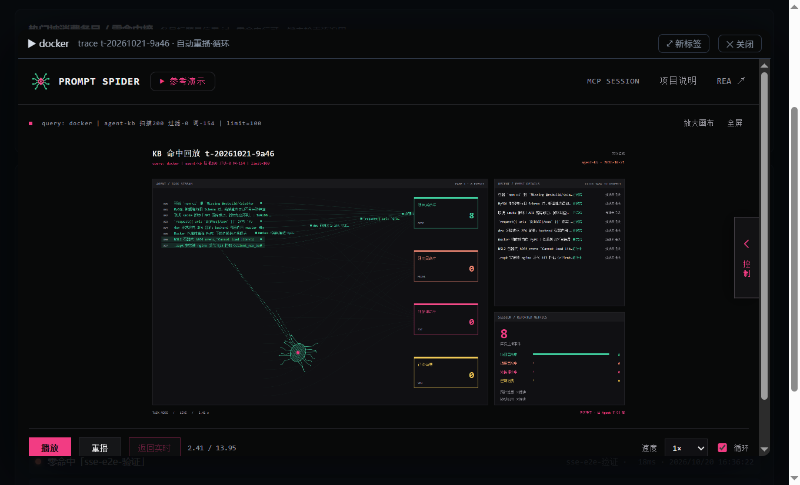
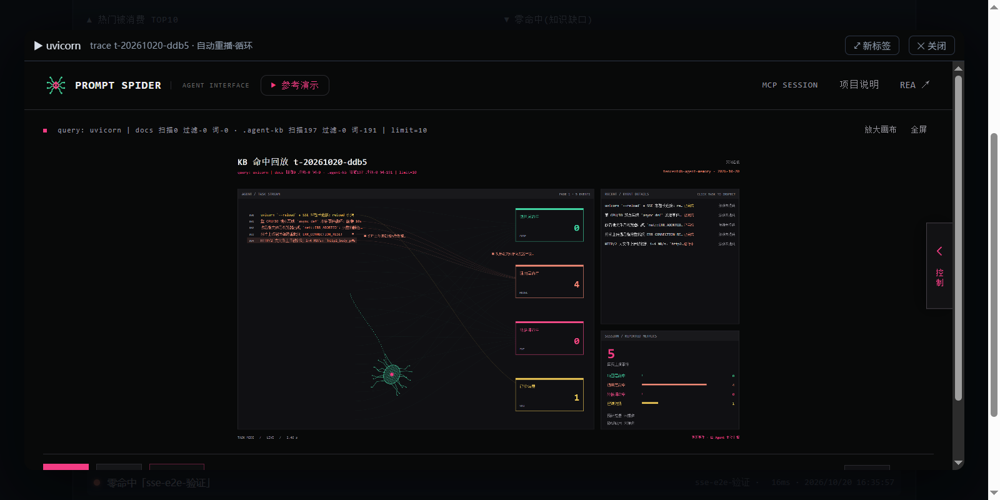
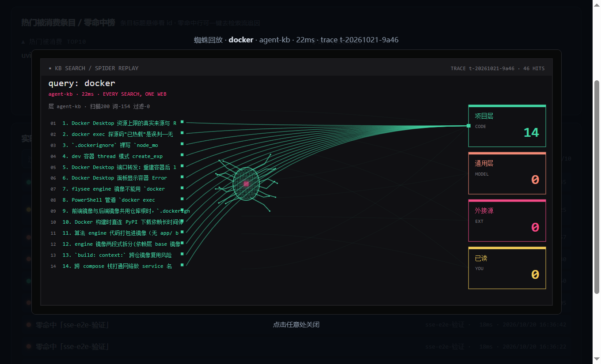
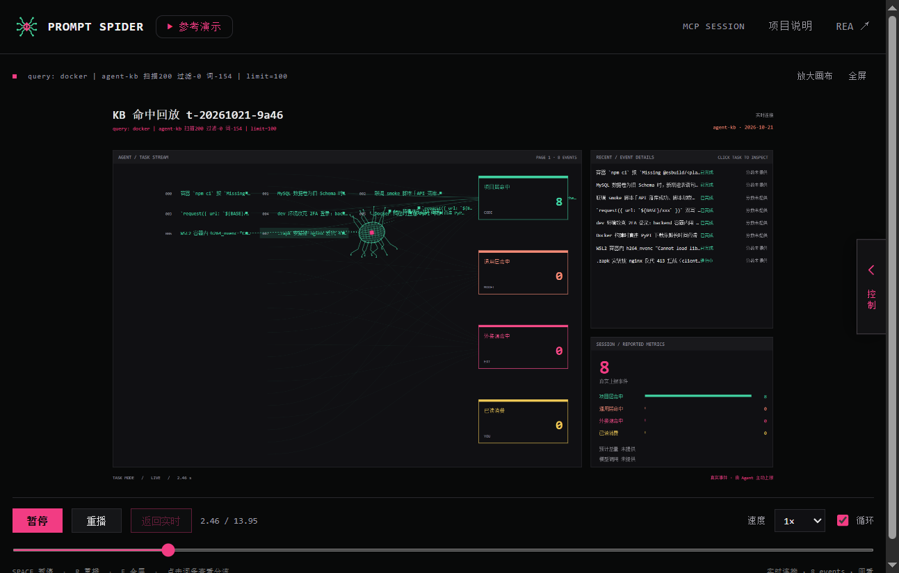
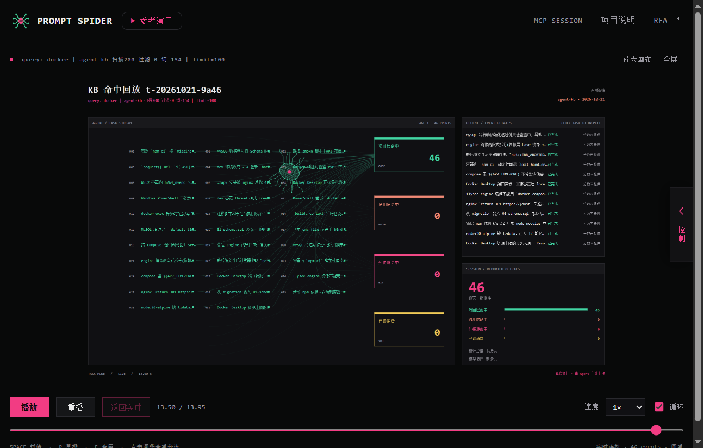

# Agent-KB 功能全覆盖测试设定（可复用）

> 首次执行: 2026-10-21 · 适用版本: 主仓 `main`(9efabe5 起)
> 目标: 验证 `kb` CLI 全命令与观测 Web 界面全功能是否正常; 本文档同时是后续
> 回归复用的**测试设定**(环境准备 → 用例 → 预期), 执行结果回填在末尾"执行记录"。
> 方法论: 缺陷处置遵循 systematic-debugging(复现→根因→最小修复→回归), 禁止症状级修补。

## 0. 红线约束

- 测试**不得污染**权威账本 `traces/`(git 管理): 数据驱动一律用沙箱目录
  (`scripts/simulate-agent.py --out <仓外目录>`), 该脚本自带拒写仓根的红线。
- 走查期间本机 CLI 检索一律 `--no-trace`(或 `$env:KB_TRACE="0"`), 避免把测试查询
  混进真实命中率统计。
- 测试产生的临时仓/临时条目放在 `$env:TEMP\kb-test-*`, 结束后删除。

## 1. 环境准备

```powershell
cd d:\Workplace\Agent-KB
# 依赖: Python 3.10+(实测 3.12)、Node 20+(仅全屏蜘蛛回放桥需要)
.\.venv\Scripts\pip install -e ".[dev]"     # 已 editable 安装可跳过
.\.venv\Scripts\python.exe -m pytest -q      # 全量单测基线
# 沙箱数据(多 caller/外接源/零命中/已读 全形态, 幂等可重生成):
.\.venv\Scripts\python.exe scripts\simulate-agent.py --out $env:TEMP\kb-sim --days 7 --seed 42
# 用沙箱起观测服务端(独立端口, 避开 4320 上可能常驻的实例):
.\.venv\Scripts\kb.exe serve --repo $env:TEMP\kb-sim --port 4321
# 浏览器打开 http://127.0.0.1:4321/ ; 真实数据对照则:
.\.venv\Scripts\kb.exe serve            # 默认 4320, root=本仓 traces/
```

## 2. CLI 冒烟矩阵

约定: `KB` = `.\.venv\Scripts\kb.exe`; `TMP` = 临时测试目录。
退出码是断言主体, stderr 文案次之。

### 2.1 常规路径

| # | 命令 | 预期 |
|---|------|------|
| C1 | `kb --help` / 各子命令 `--help` | exit 0, 列出全部子命令 |
| C2 | `kb new howto --domain tooling --scope project --title <t> --repo TMP`(先 `kb init --repo TMP --kb-dir docs`) | exit 0, 打印文件路径, status=proposed, 套用模板 |
| C3 | `kb new pitfall --domain backend --scope project --title <t> --generated --repo TMP` | exit 0, status=draft + confidence=speculative(门控) |
| C4 | `kb lint --scope project --repo TMP` | exit 0, 无硬错误 |
| C5 | `kb index --repo TMP` → `kb index --check --repo TMP` | 先打印 3 个 wrote 路径, check 输出 `index up to date` exit 0 |
| C6 | 手改条目正文后直接 `kb index --check` | `index stale` exit 1(漂移可检出) |
| C7 | `kb search --query "<已有词>" --repo TMP --no-trace` | exit 0, JSON 数组, 只含元数据+摘要(无正文) |
| C8 | `kb show <id> --repo TMP` | 全文; 未知 id → `not found` exit 1 |
| C9 | `kb related <id> --repo TMP` | JSON(有 related 则含之) |
| C10 | `kb stat --repo TMP` / `--due-review` / `--needs-scope --format md` | JSON / JSON / Markdown 表格 |
| C11 | `kb review <id> --to proposed --repo TMP` → `--to accepted --evidence "..." --confidence verified` | status 流转成功并打印 front-matter |
| C12 | `kb promote <id> --to stack --repo TMP` | front-matter 加 needs-scope-review 建议, 不改 scope |
| C13 | `kb set-scope <id> stack --repo TMP` | scope 落 stack, 清 needs-scope-review |
| C14 | `kb export <id> --to-repo <另一临时仓> --to-scope stack --repo TMP` | 目标仓出现条目, `source.project` = 源仓名(非 kb-dir 尾名) |
| C15 | `kb init --repo TMP2 --kb-dir docs`(未挂 submodule) | 单层 .mcp.json, 无绝对路径泄漏 |
| C16 | `kb doctor --repo TMP2` | 全 PASS/WARN, exit 0; FAIL 才 exit 1 |
| C17 | `kb trace list --repo $env:TEMP\kb-sim` / `--zero-hit` / `--caller agent-kb` | 表格含时间/caller/命中/query+trace_id |
| C18 | `kb trace show <tid>`(取自 C17) | 单事件 JSON |
| C19 | `kb trace export --latest --repo $env:TEMP\kb-sim -o $env:TEMP\t.json` | 生成 spider 格式 record, 含 steps |
| C20 | `kb trace report --repo $env:TEMP\kb-sim` / `--format json` | 零命中榜+消化率; json 结构含 digest_rate |
| C21 | `kb web --no-browser --port <空闲口>` | 打印 URL, 后台代拉起 serve 成功 |

### 2.2 负例与红线

| # | 命令 | 预期 |
|---|------|------|
| N1 | `kb serve --bind 0.0.0.0 --port <口>`(无 token) | **拒绝启动** exit 2, 提示必须 token(红线) |
| N2 | `kb review <draft条> --to accepted --as-agent --repo TMP`(无 evidence) | exit 1 拒绝(agent 自审必须留证据) |
| N3 | `kb review <id> --to accepted --confidence speculative --evidence x --repo TMP` | 拒绝(speculative 永不 accepted) |
| N4 | `kb lint --scope wrong --repo TMP` | argparse exit 2(拼错即拒, 不静默) |
| N5 | `kb new` 重复标题(高相似) | `duplicate` candidates JSON exit 1(查重门控) |
| N6 | `kb trace export`(id 与 --latest 同给/同不给) | exit 2 二选一 |
| N7 | `kb search --query "绝对零命中词xyz" --no-trace` | exit 0 空数组(不报错) |
| N8 | `kb spider-live`(无 Node/未装克隆依赖时) | 友好报错 exit 2, 不裸 traceback |

## 3. Web 界面全功能走查(浏览器)

数据源: 沙箱 `$env:TEMP\kb-sim`(serve --port 4321)。每用例记录"实际=预期?"。
浏览器须开 DevTools Console, **任何未捕获 JS 异常都算 FAIL**。

| # | 区块 | 步骤 | 预期 |
|---|------|------|------|
| W1 | 加载 | 打开 `http://127.0.0.1:4321/` | 无 console 错误; 右上 `● 已连接`; KPI 4 卡有数 |
| W2 | 时间窗口 | 点 7天/30天/全部 | KPI/双榜随窗口变化; 按钮高亮切换; "全部"时无 since 参数 |
| W3 | 单项目视图 | 打开 `?caller=agent-kb` | KPI 只含该项目; 矩阵卡隐藏 |
| W4 | 联邦视图 | 点"多项目联邦" | 矩阵卡显示 3 caller; 列: 检索数/命中率/按源堆叠/外接源/最近活跃/状态 |
| W5 | 外接源健康 | 看 tencentdb-agent-memory 行"外接源"列 | ●tdbm 绿/红点(8% 注入错误), title 显示 ok/error |
| W6 | stale 标记 | 看矩阵 stale 列 | 有 >14d 未活跃行则红字"⚠ trace 掉线"(数据相关) |
| W7 | 矩阵下钻 | 点某项目行 | 切回单项目视图+绿色横幅"已下钻到项目 x" |
| W8 | 双榜 | 看热门被消费/零命中两列 | 条形宽度比例正确; 标题悬停显 id; 空态有引导文案 |
| W9 | 零命中追因 | 点某零命中行"追因→" | 检索流过滤到该 query 且滚动到位, 状态段=零命中 |
| W10 | 检索流快照 | 打开即见历史条目 | 圆点色: 绿=命中/红=零命中/黄=已读; 右侧 mono 显示 query·ms·时间 |
| W11 | 实时 SSE | 沙箱目录追加一行 search 事件(`Get-Content x | Add-Content ...`或重跑 simulate 尾部) | ≤2s 新条目出现在流首, 动画淡入 |
| W12 | 过滤 | 搜索框输入词; 分段切 全部/命中/零命中/已读 | 计数 `n/total` 正确; 无匹配显示空态文案 |
| W13 | 蜘蛛回放 | 点击命中条目 | **就绪态**: main 内播放坞展开(iframe, 不遮罩页面); **不就绪态**: 弹层 SVG 动画(蜘蛛巡游+触须+彩点飞入分箱); 头部含 query/caller/ms/trace |
| W14 | 键盘可达 | Tab 到条目按 Enter/空格 | 同 W13; Escape 先关 SVG 弹层, 再按则收起播放坞 |
| W15 | 零命中回放 | 点零命中条目 | 舞台显示"零命中 — 死因见左侧各层淘汰计数", 左侧列各层扫描/淘汰 |
| W16 | 播放坞换 trace | 坞已展开时再点另一条目 | iframe 就地换新 trace(dock 数量恒为 1, 不叠加); src 带 `chrome=none` |
| W17 | 回放缓存 | 收起坞→点细栏重展开 / 连续切多个 trace | 重展开秒开(serve 端会话缓存, ≤15 逐旧腾新); 无报错 |
| W18 | 断连恢复 | 杀掉 serve 再重启 | 右上变"● 断连(重试中)"红色脉冲; 重启后恢复"已连接" |
| W19 | traces 缺失 | 空目录起 serve → 打开 | 横幅提示"traces/ 目录不存在"而非白屏/报错 |
| W20 | token 鉴权 | `kb serve --port 4322 --token t123`; 直接开 `:4322/`; 再开 `:4322/?token=t123` | **页面 `/` 本身也受鉴权**(红线: 不泄露面板)→ 无 token 得 401 JSON; 带 `?token=t123` 页面+全部数据正常; 无 token 的 `/api/stats` 返回 401, 错 token 401 |
| W21 | API 面 | curl `/healthz` `/api/health` `/api/stats` `/api/feed` `/api/callers` `/api/replay/<tid>` `/api/replay/bad` | 200+合法 JSON; 未知 replay id → 404 JSON |
| W22 | ingest 口 | POST `/api/ingest` 合法/带 content 键/重发同 trace | ok / 400 / deduped:true(幂等) |
| W23 | 稀疏 trace 形态 | 手工 append 最小 trace(无 matched.title、rejected 无 filter 子键, 记得带 meta 首行) → 点其条目开播放坞 + curl `/api/replay/<tid>` | 桥正常出 iframe; replay 200 且 label 回退 id(禁止断连/Failed to fetch) |
| W24 | 竞态压力 | 快速连切 窗口×视图×单项目 ≥8 次, 再查 console | 0 未捕获 JS 错误; 最终态与最后一次点击一致(矩阵显隐/feed 数/连接态) |
| W25 | 追因兑现 | 零命中榜点一个**不在最近 30 条 feed** 的旧 query"追因→" | 自动扩大快照后命中并滚动定位(非"没有匹配"误导文案) |

## 4. 缺陷处置流程(每个 FAIL 走一遍)

1. 取证: console 报错原文 / 网络面板响应体 / 最小复现步骤, 稳定复现 ≥1 次;
2. 查变更: `git log -p -- <涉事文件>` 找引入点;
3. 追数据流: 从 UI 事件倒推到 serve 路由 → stats 口径 → trace 解析, 定位根因层;
4. 单一最小修复 + 必要时加回归测试(pytest 或走查用例);
5. 回归: `pytest -q` 全绿 + 该走查用例复测通过, 记入执行记录。

## 5. W11/W6 数据注入片段(走查复用)

```powershell
# W11 SSE 实时推送: 向沙箱当日文件追加一条最小 search 事件(目录已有带 meta 首行的文件时)
# 注意: 新建分片文件必须先写 {"kind":"meta","schema":2,...} 首行, 否则整文件被 _parse_file 跳过
# W6 stale 标记: 向 today-21d 日期分片写 meta+一条 search(caller 用独立名), 联邦视图"全部"窗口应显"⚠ trace 掉线(>14d)"
```

## 6. 执行记录(2026-10-21 首跑)

- 环境: Python 3.12.13(venv) / Node v22.23.2 / Windows / 基线 commit `9efabe5`
- **pytest**: 274 passed(修复后 275, 新增 1 条守护测试), 无失败
- **CLI 冒烟**: C1–C21 + N1–N8 全部 PASS(36 断言 0 失败)。要点: 门控红线(N1–N4/N6)、查重(N5)、
  漂移检出(C6)、export 的 source.project 取 git 仓名(C14)、doctor 裸仓 FAIL 明示(C16b) 均符合预期。
  `spider-live` 本机依赖就绪, 实测 3s 内对沙箱 7 条 search 建会话出 previewUrl(正向通过)。
- **Web 走查**: W1–W22 全部 PASS(其中 W6/W8–W17/W19–W22 在修复 D-1 后于 token 实例
  4332 与无 token 实例 4321 双态复测)。
- **缺陷清单与修复**(systematic-debugging 闭环, 均已回归):
  | # | 症状 | 根因 | 修复 | 验证 |
  |---|------|------|------|------|
  | D-1 | token 态(`serve --token` 或 `kb web` 开团队 URL)下页面可加载但 KPI/双榜/检索流全空, 误报"需要访问令牌" | 面板 `loadStats`/`loadFeed`/`/api/health` 三处 fetch 漏拼 token(同页 callers/spider/SSE 均带, 携带不一致) | index.html 三处 fetch 统一 `&token=` ; 新增静态守护测试 `test_panel_api_fetches_carry_token` | 浏览器复测 token 态全量渲染 OK; pytest 275 全绿 |
  | D-2 | serve 重启后连接指示永久停留"● 断连(重试中)", 即使 SSE 已重连成功 | EventSource 只挂了 `onerror`, 无 `onopen` 恢复路径 | 加 `es.onopen=()=>conn(true)` | 杀 serve→断连红色→重启→≤10s 自动恢复"● 已连接"(浏览器实测) |
- **环境观察项(非代码缺陷)**:
  1. 走查中发现 4321 端口 SSE 不广播 — 根因是前次会话残留的多个 serve
     进程父子链占住端口(Windows 下新起同端口实例行为异常)。清理残留进程后消失。
     复用本设定测试前**先杀干净旧 serve**(`Get-NetTCPConnection -LocalPort <port>`)。
- **知识沉淀**(落 `docs/kb/` scope=project, agent 自审 accepted, 带证据, 先 search 去重无命中):
  - `kb-20261021-0570` 前端多处手拼鉴权 token 参数漂移导致部分 API 静默 401
  - `kb-20261021-d3d2` traces 分片缺 meta 首行导致整文件事件被静默跳过
  - 观察项 1(残留进程)判定为一次性环境态, 按收录标准不进库。
- **遗留建议**: W16 全屏桥的 iframe 内容浏览器工具不可穿透, 其内部交互(导入导出/
  换肤)未覆盖, 属克隆仓职责范围。

## 7. 二轮整改记录(同日, 处理首跑遗留项)

| 项 | 处置 | 验证 |
|---|---|---|
| `kb new` 缺 `--severity` | 已加参数(choices 同 taxonomy 枚举): generated 路径透传 `create_draft(severity=)`, 人工路径覆盖模板默认 medium(与 MCP `kb_create` 对齐) | 实测 generated=high / human=critical / 缺省=medium 三路径 + lint exit 0 |
| 堆叠条 title 窄列截断 | 每段 title 改为**整条汇总**("project: N 次(x%) / ext:tdbm: N 次(y%)"), 段加 `min-width:3px` 保证小占比可悬停 | 浏览器实测矩阵堆叠段 title 为完整汇总串 |
| 面板 fetch 手拼 token | 新增 `apiUrl(path)` 统一注入器, **全部** 6 处 fetch + SSE EventSource 收口; 守护测试升级为"fetch/EventSource 的 /api/* 字面量禁止手拼, 必须走 apiUrl" | 网络面板实测所有请求带 token; 守护测试通过 |
| D-1 次生症状: 401 JSON 被当数组(`rows.slice is not a function`) | `loadFeed`/`loadMatrix` 补 401 短路(交 loadStats 统一出横幅), 消除 token 中途失效时的裸 TypeError | node --check 0 + pytest 275 全绿 |
| 控制台"24 条日志"逐条分析 | 除上述 TypeError 为真实(次生)缺陷已修外, 其余均为: 测试驱动 SSE 的正常断流(ERR_ABORTED/REFUSED/RESET, W18 场景), 测试脚本自身的探测语法错误(已改为合法脚本), 全屏桥 serve 停止时的 live.js 断流 | 详见对话记录; 无需改代码 |

## 8. 二轮回归走查(同日, apiUrl 重构后)

**回归项全部通过**: 无 token 态基础/KPI/双榜/feed 全量、窗口×视图 9 连切竞态压力(0 JS 错误)、
零命中追因、token 态 SSE 实时推送、token 态全屏桥(修复 D-4 后)。

**新发现并修复 2 个缺陷**:

| # | 症状 | 根因 | 修复 | 验证 |
|---|------|------|------|------|
| D-3 | 零命中榜对窗口内旧事件"追因→"→ 0 匹配 + 误导文案"试试更短的关键词" | 零命中榜聚合**整个窗口**, 追因实为前端过滤 feed 快照(仅最近 30 条)——承诺与实现对不上, 命中与否取决于事件是否碰巧在 30 条内 | 新增 `drillTo(q)`: 快照内 0 匹配自动扩 limit=500 重查再过滤(`loadFeed(limit)` 参数化) | 浏览器实测"postgres vacuum"(快照外)追因 → 自动扩快照命中 2 条, 计数 2/95 |
| D-4 | 全屏蜘蛛桥/`/api/replay` 对某些 trace 直接掐连接(浏览器只见 Failed to fetch) | `spider_export.to_record` 裸取 `m["title"]`/`rejected["filter"]`, 手工/早期 schema trace 缺键 → HTTP 线程 KeyError 未捕获 → 连接裸掐 | 读侧 `.get` + 语义回退(title→id, rejected→0); 新增 `test_sparse_legacy_trace_no_crash`(先失败后通过) | API 层 replay 由断连变 200(label 回退 id); 浏览器 token 态全屏桥 iframe 正常加载 |

**走查方法教训(写入设定)**:
1. **数据形态要多样**: 首轮全部用仿真脚本数据(字段齐全), 掩盖了 D-4 这类"读侧对稀疏
   trace 不防御"的缺陷; 二轮手工最小 trace 一次触发。后续走查必须同时喂仿真数据与
   手工最小/稀疏 trace。
2. **token 态须覆盖全部端点**: 首轮 W16 在全本机无 token 实例验的桥, token 态从未验过;
   后续 API 面用例(W21)应在带 token 实例上复跑一遍。
3. 竞态压力(快速连切按钮)可作为常设用例: 本次 9 连切 0 错误, 值得保留。

**本轮知识沉淀**: `kb-20261021-1b60` append-only trace 账本读侧裸取字段致 API 线程
KeyError 掐连接(accepted/verified/agent 留痕)。最终回归: pytest **276 passed**、
index/lint 全绿。

## 9. 三轮改造: 回放默认 iframe 化 + 命中行可读性(同日)

**交互模型变更**(用户拍板的折中方案):
- serve `SpiderBridge.ready()` 轻量探测(node + 克隆仓 + mcp 依赖, 不启动子进程, 结果缓存),
  经 `/api/health.spider_ready` 暴露。
- 面板 boot 读取该标志: **就绪 → 点条目直开全屏 iframe**(SVG 隐藏、动画停止, 点"收起"
  恢复 SVG 重播, 关弹层一并释放); **不就绪/桥意外失败 → SVG 兜底**(现状路径不变)。
- 验证: 4321(就绪)直开 iframe/收起回 SVG/Escape 关闭重开全通过; 4325(无 node)SVG 路径不变;
  `/api/health` 两态 spider_ready true/false 正确。

**命中行可读性**(用户反馈: `kb-xxxx·title` 不可读):
- `feed_events.details` 透传 `matched.title`(stats.py, 测试锁死);
- SVG 命中行显示**人类可读标题**(`hitLabel()`, 与 spider_export.label_of 同口径),
  完整标题+条目 id 收进 SVG `<title>` 悬停; 无标题的老 trace 回退旧格式 `id·hit_fields`。
- 守护测试 2 处: `spider_ready` 类型/缓存一致、details.title 透传。

## 10. 四轮改造: 播放坞(方案 B) + 克隆仓 chrome=none(同日)

**交互模型再变更**(用户看过 A/B/C 三布局原型后拍板 B): 回放从"模态遮罩弹层"改为
**main 内播放坞 `#dock`**(KPI 卡下方), SVG 弹层退居纯降级路线。

- **就绪态(spider_ready=true)**: 点条目 → 坞展开(不遮罩, feed/榜单仍可见), iframe 加载
  `previewUrl`(带 `chrome=none`, 默认自动重播+循环); 坞已开时点另一条目=**就地换 trace**;
  "✕ 收起"→ 43px 细栏(卸 iframe 省资源), **点细栏体秒重展开**(会话在 serve 端缓存);
  桥意外失败 → 坞隐藏, 自动降级 SVG 并在弹层头部提示错误。
- **不就绪态**: 坞全程隐藏, 点条目开 SVG 弹层(头部标注"蜘蛛桥不可用…已降级 SVG 动画")。
- **Escape 语义**: 先关 SVG 弹层, 弹层未开时收起播放坞。
- **serve**: `_embed_url()` 给 previewUrl 的 query 段追加 `chrome=none`(`#token` 片段不动,
  不进缓存键); 老克隆仓不识别该参数也无副作用。
- **克隆仓(prompt-spider-ui)**: `boot.js` 识别 `?chrome=none` → `body.chromeless`;
  `style.css` 复用 immersive 布局隐藏 topbar/inspector/transport/drawer, 画布占满视口。
- **守护测试**: `/api/spider` 断言 `chrome=none in previewUrl.split('#')[0]` +
  `{loop:true, action:"restart"}` 下发; pytest 276 全绿。
- **验证**: 4321 就绪态坞展开/换 trace/收起重展开/chromeless 画面(topbar 隐藏, 画布占满)/
  循环回绕/Esc 收坞 全通过; 4325 不就绪态坞隐藏、SVG 弹层+命中行标题正常、Esc 关闭正常。
- **环境陷阱(本仓多次踩坑)**: serve 启动时一次性读入 index.html, **改前端必须重启 serve**;
  重启前必须确认端口无残留旧进程(`Get-NetTCPConnection -LocalPort <p>` 逐个核对
  CommandLine 再杀), 并以 `dock in served HTML` 探针确认服务的是新代码。
  **杀进程正则必须是 `kb(\.exe"?)?\s+serve|kb\.cli\s+serve`**——PowerShell 列出的 CommandLine
  有两种形态: `"…kb.exe" serve`(exe 带引号)与 `"…python.exe" -m kb.cli serve`(模块形态),
  窄正则漏杀任一种→新进程绑不上端口、继续服务旧 HTML(六轮改造再次踩中 `-m kb.cli` 形态)。

## 11. 五轮逐屏回归(播放坞改造后, 同日)

**前置清理**: 全量枚举残留 serve(`Get-CimInstance Win32_Process | ? CommandLine -match
'kb\.exe serve'`)——发现 4321 上叠了**双进程**(同秒两份), 4325 上先后有两批旧代码进程
(即"服务旧 HTML"根因); 全杀 → 端口 0 监听 → 全新启动 → 三探针通过
(`spider_ready=True` / `dock in HTML` / `fullFrame 已移除`)后才开始走查。

| 用例 | 结果 | 关键证据 |
|------|------|----------|
| W1 加载 | PASS | ● 已连接; KPI 5 组有数(87.4%/95 次); feed 30 |
| W2 窗口 | PASS | 7天↔全部 KPI 变化(95→96 次) |
| W3/W4 视图 | PASS | 单项目 table 隐藏(offsetParent=0); 联邦 3 caller 矩阵显示 |
| W5 外接源 | PASS | ●tdbm title=ok; 堆叠 title `project:196(85%)/ext:tdbm:34(15%)` |
| W6 stale | PASS | tale-caller-x 行 STALE 类(09-30 活跃) |
| W7 下钻 | PASS | 点 flysee 行→横幅"已下钻到项目 flysee-video-web"; KPI 切 7 次检索 |
| W8 双榜 | PASS | 热门 TOP6 标题可读; 零命中榜带"追因→"; "已消化 ✅"标记正常 |
| W9/W25 追因 | PASS | 填 query+过滤到 1 条+无"没有匹配"误导 |
| W10 feed | PASS | dot g/r 色、query·ms·时间齐全 |
| W11 SSE | PASS | 注入"W11 实时注入验证"≤2s 出现在流首 |
| W12 过滤 | PASS | sse→1/7; 无匹配→`#feedEmpty` 引导文案; 清空复原 7/7 |
| W13 坞展开 | PASS | dock block、src 带 chrome=none、modal 不开、feed 仍可见 |
| W14 键盘 | PASS | tabindex=0; Enter/Space 开坞; Esc 先弹层后收坞 |
| W15 零命中 | PASS | 零命中条目也走坞(iframe chrome=none) |
| W16 换 trace | PASS | docks 恒 1, src 就地换 session, 标题同步 |
| W17 收起重开 | PASS | 收起→38px 细栏+iframe 卸载(about:blank); 点栏秒重开 |
| W19 空目录 | PASS | "trace / 目录不存在 — 观测尚未开启"横幅 |
| W20 token | PASS | `/` 401; `?token=t123` 200; 错 token 401 |
| W21 API | PASS | 6×200 + 未知 replay 404 |
| W22 ingest | PASS | ok:true / 400 / deduped:true |
| W23 稀疏 trace | PASS | 无 title trace → replay 200 且 `"label":"kb-…-a1b2"` 回退 id; 浏览器坞正常出 iframe。**注**: 注入最小 trace 必须带 `returned` 数组, 否则 0 事件(仅 configure/complete, 属预期语义) |
| W24 竞态 | PASS | 8 连切后终态一致; 14 条 console 全为测试驱动噪音(旧页签 ERR/EventSource ERR_ABORTED/驱动脚本笔误), 0 产品异常 |

**观察项(非缺陷)**: 矩阵下钻只改内存视图与横幅, 不重写 URL 的 `?caller=` 参数——刷新后
回到下钻前的视图。若需可分享链接语义, 后续可在下钻时 `history.replaceState`。

**测量教训**: feed 过滤是 `display:none` 隐藏而非移除 DOM, 断言可见数必须用
`offsetParent!==null`, 数 `.feed-item` 总数会得出"过滤失效"的假阴性。

**收尾**: 临时 serve(4322 token/4323 空目录)用完即杀并验证 0 监听, 防制造新残留。

## 12. 实现方案: 视图状态写入 URL(history.replaceState)(已实施, 实测见 §14 F)

**动机**(§11 观察项): `view/caller/win` 只存活于内存——下钻改 `caller` 不回写 URL, 刷新即丢;
链接不可分享(Grafana/Datadog 等观测面板均把关键视图状态放 URL, 见 §13 佐证)。

**状态↔URL 契约**(与现有 `callerParam()` 语义对齐):

| 状态 | URL 表示 | 缺省 |
|------|----------|------|
| 单项目(默认) | 无 `caller` 参数 | `caller=''` |
| 下钻单项目 | `caller=<repo>` | — |
| 联邦 | `caller=*` | — |
| 时间窗口 | `w=7\|30\|0`(0=全部) | `w=7` |
| token | 原样保留, 本方案不触碰 | — |

**实际落地代码**(`src/kb/web/index.html`, 共 4 处, 与源码同步):

```js
// ① 脚本头部: 启动恢复 + 同步器(单一真源 view/caller/win)
let caller=qs.get('caller')||'';  let view='single', win=7;
if(caller==='*'){view='fed';caller='';}          // caller=* → 联邦
if([7,30,0].includes(+qs.get('w')))win=+qs.get('w');   // 非法 w 回退 7
function syncUrl(push){
  const p=new URLSearchParams(location.search);   // 在现有参数上改 → token 天然保留
  if(view==='fed')p.set('caller','*');
  else if(caller)p.set('caller',caller); else p.delete('caller');
  p.set('w',String(win));
  history[push?'pushState':'replaceState']({view,caller,win},'',
    location.pathname+'?'+p+location.hash);
}
// ② render(push) 内统一调用: syncUrl(push); 下钻处 render(true) 入栈
//    (矩阵行 onclick → render(true), 浏览器返回键=回退下钻前的联邦视图);
//    视图/窗口切换 render() → replaceState, 不污染历史。
// ③ boot 末尾: history.replaceState({view,caller,win},'',location.href);
//    固化初始态, 保证第一条 popstate 有 state。
// ④ 前进/后退(以 URL 为准重新解析, 而非读 e.state):
addEventListener('popstate',e=>{const p=new URLSearchParams(location.search);
  view=p.get('caller')==='*'?'fed':'single';
  caller=p.get('caller')&&p.get('caller')!=='*'?p.get('caller'):'';
  if([7,30,0].includes(+p.get('w')))win=+p.get('w');
  render();});
```

**与初稿的两处差异**(实施时修正):
1. `popstate` 从"解构 `e.state`"改为**重新解析 URL 参数**——直接输入/分享链接进入的首条历史
   没有 state, 统一以 URL 为准可覆盖全部路径(state 仅作快恢复冗余);
2. `syncUrl` 不在各调用点手写, 收进 `render(push)` 统一出口——新增视图切换入口不会漏同步。

**注意**: `qs` 是启动时快照, `apiUrl()` 取 token 不受 pushState 影响(同文档 token 不变);
`syncUrl` 基于 `new URLSearchParams(location.search)` 增删, 未触碰的参数(如 `token`/`degraded`)
原样透传 → W26d 由代码结构保障(token 经下钻/切换后仍在 URL, API 不 401)。

**验收结果**(W26, 实测 §14 F): a 刷新复现 ✅ b 浏览器返回回联邦 ✅ c `w=30` 分享复现 ✅
d token 透传(结构保障, 闸门口径另由 W20 守护) ✅。

## 13. 使用者视角逐屏走查(截图取证, 同日) + UX 佐证

**业界佐证**: 观测面板应"降低认知负荷而非增加"(Grafana 官方仪表盘最佳实践);
流式组件(stream widget)应放在版面末端避免"困住滚动"(Datadog 集成规范);
关键视图状态编码进 URL 以支持分享/刷新复现是通行做法(state-in-URL 模式,
DevExpress 的 IncludeDashboardStateToUrl、react-router 等均内置)。
来源: Grafana docs "Dashboard best practices" · Datadog "integrations-core dashboard
guidelines" · kiboschool "State in URLs" · npm state-in-url。

**逐屏观察 → 优化建议**(按优先级):

| 级别 | 屏区 | 观察(实测) | 建议 |
|------|------|-----------|------|
| P0 | 检索流 | 条目命中仍显示 `kb-20261013-7737, …` 裸 id——与用户已反馈过的"SVG 命中行要可读标题"同源; `details.title` 后端已透传, 前端未用 | feedItem 用 `raw.details[id].title` 优先渲染(截断+title 悬停显 id), 与 `hitLabel()` 同口径 |
| P0 | 播放坞 | `chrome=none` 隐藏了克隆仓 transport——**用户失去暂停/进度控制**, 循环只能收起或换 trace | dockBar 加 ⏯ 按钮, 经 serve 代理桥发 `spider_control_playback {paused}`; 或坞 Esc 兼作暂停 |
| P1 | 播放坞 | 高 46vh(303px)下 landscape 画布两侧留黑、动画仅约 400×250, 文字难辨(与用户"尽量占用界面"诉求冲突) | 默认 60vh + dockBar 加 ⤢ 切换 90vh 沉浸档; iframe 高度让画布接近 16:9 满宽 |
| P1 | 视图切换 | 展开坞后切"多项目联邦", 坞仍占首屏, 矩阵被推出视口(实测 matrixTop=-1029) | `render()` 里视图/窗口切换时自动 `dockClose()`(细栏可秒回) |
| P1 | 全局 | 视图状态不写 URL(§12 方案待落地) | 按 §12 实施 W26a-d |
| P2 | 时间窗口 | "7天"无具体日期范围, 口径需脑算 | 窗口按钮 tooltip 显示 `since≈YYYY-MM-DD` |
| P2 | 榜单 | "追因→"仅 12px 小按钮可点 | 零命中整行可点(与条目标题同行响应) |
| P2 | 检索流 | 过滤框无键盘快捷键; 切换视图瞬间 feed 清空无骨架 | `/` 聚焦过滤框; loadFeed 期间显示 2-3 行骨架条 |
| P2 | 热门榜 | 标题 CSS 截断后悬停 title 只有 id(截图文案"悬停看 id") | title 改"完整标题 · id" |

**控制台 17 条判读(0 产品缺陷)**: 4325 连接拒绝 ×2=浏览器残留旧页签对已杀服务重试 SSE;
 `/api/stream` 与克隆仓 `/api/sessions/*/events` 的 ERR_ABORTED ×12=切视图/换 trace/导航时
 EventSource 与 iframe 被正常中断(浏览器网络层日志, 非 JS 异常);
 SyntaxError/TypeError ×2=测试驱动脚本自身笔误。**均无需修复**, 清掉残留页签即净。

**追加需求已落地(同日)**: ① 热门榜 TOP6→**TOP10**(标题+slice 同步);
② 面板所有时间统一为 **Asia/Shanghai 本地串直通格式 `yyyy/MM/dd HH:mm:ss`**(`fmtTs()`,
矩阵"最近活跃"/feed 快照/SSE 新条目三处; ts 本就是写入机上海时间, 不做浏览器时区换算;
SSE 条目原缺时间字段, 已补显)。

## 14. 四轮改造: 检索流分页 + 定宽对齐 + P0/P1 打包(已实施+实测)

**需求**: ① 检索流分页(页码条, 50/页); ② mono 行耗时定宽对齐; ③ §13 的 P0/P1 全量带上。

**改动**(全部单文件可回滚):

| 块 | 实现 | 守护/实测 |
|----|------|----------|
| A 分页 | `feedArr` 数组真源(新→旧, API 已排序**直存勿 reverse**——实施时曾误 reverse 致最旧置顶, W27a 抓到); `renderFeed`=过滤→切页→页码条(窗口≤5+首尾+省略号); `loadFeed` 一次拉 500; 过滤/换条件回页1; SSE 仅页1重渲染(读旧页不打断); 追因 drillTo 简化(500 条内直滤) | W27a `155/155·第1/4页·页1满50` ✅; W27b 翻页换数据 ✅; W27c 过滤回页1 ✅; W27d SSE 新事件落页1首条+`new` 动画 ✅ |
| B 定宽 | `.mono .dur{inline-block;min-width:5.5ch;right}`; 时间列 fmtTs 恒 19 字符 | W28: 50 行 `.mono` 右缘坐标**唯一**, `.dur` 实测恒 33px ✅ |
| C 可读标题 | `hitTitle/feedLabel`(标题截断 24 字, `details.title` 优先, 与 hitLabel 同口径); 悬停 title=`完整标题 · id`; `feedHay` 含标题(过滤可搜标题词) | W29: feed 显示`命中 W27实时条目标题-可读`, tip=`…-可读 · kb-20261013-7737` ✅ |
| D ⏯ 控制 | serve `POST /api/spider/<tid>/control`(token 同闸门, CTRL_KEYS 白名单过滤); 面板 dockBar ⏯, 换 trace 复位 | pytest `test_api_spider_control_proxies_and_filters`(透传/白名单503/未知404/无token401) ✅; W30b 点击→`▶`且桥收到 `{paused:true}` ✅ |
| E 尺寸避让 | 默认 46vh→**60vh**; ⤢ 切 90vh(localStorage `kb-dock-tall` 记忆); `render()` 开头自动 `dockClose()` 避让 | W30a 396px=60vh ✅; W30c 594px=90vh+ls=1 ✅; W17 切视图→43px 细栏+iframe 卸载→点栏秒重开 ✅ |
| F URL 状态 | §12 方案落地: `syncUrl(push)` 下钻 pushState/切换 replaceState; boot 恢复 `caller=*`+`w` 白名单; `popstate` 以 URL 为准复原三元组 | W26a 刷新复现联邦+30天 ✅; W26b 下钻→URL `caller=…`→**浏览器返回**回联邦 ✅; W26c 切窗口 `w=30` 可分享 ✅ |

**回归**: pytest **277** 全绿(+control 用例); node --check/py_compile 过。

**新增测试数据陷阱**: PowerShell `ConvertTo-Json` 发中文 body 会转码破坏(`?????`)——
造数注入改用**浏览器内 fetch**(UTF-8 干净)或 Python 发请求; 断言文案勿依赖 PowerShell 注入的中文。

## 15. 六轮改造: 回放整页化(取消 iframe 播放坞) + 时间轴逐条展开(已实施+实测)

**动机**(用户对照 preview.gif): 回放"太简单、蜘蛛像固定动作"。根因三条——
① gif 是克隆仓 **reference demo** 模式(20.92s 预设 175 词逐个扫描), 我们回放走 **live session**
模式, 布局本就不同; ② 导出时间轴把全部命中挤在 at=0.5/1.5 两点, 动画 1s 闪完只剩蜘蛛空转;
③ 2.5s 循环里 16s 周期的蜘蛛椭圆只走 1/6 弧, 观感=抖动+跳变。

**决策**(brainstorm 两轮确认): 取消 iframe 嵌入, 直接用克隆仓整页 session 视图(自带
transport/inspector); 只展开时间轴(不动克隆仓 livePose 周期); 总时长封顶≈14s;
新标签打开(固定窗口名复用); 词墙布局本轮不做(先看效果)。

**改动**:
- **面板** `src/kb/web/index.html`: 删播放坞全套(HTML/CSS/dockPlay/⏯/⤢/避让/Esc 收坞);
  `openReplay()`=手势内同步 `window.open('about:blank','kb-spider-replay')` 防弹窗拦截,
  fetch 到 previewUrl 后赋 `w.location`; 失败关标签回落 SVG 弹层(`_replayErr` 标注)。
- **serve** `src/kb/serve.py`: 删 `_embed_url()`(整页不需要 chrome=none)与
  `POST /api/spider/<tid>/control` 代理(transport 原生自带); `loop+restart` 下发保留。
- **spider_export** `src/kb/spider_export.py`: 逐条 stagger 时间轴——首条 at=0.5,
  `stag=min(0.6, max(0.12, 11/(n-1)))`, 每条 running→(+0.45)completed, 尾缓冲 2s;
  零命中/全 you 保持 2.5s 短轴。**关键坑**: stagger 下限(0.12)<fly(0.45)时下一条
  running 比上一条 completed 先到, 顺序产 log 会 at 倒退被对端 validateRecord 拒收 →
  必须按 (at, 同刻序) 排序后再编 revision。you 随首批落定, >99 溢出单独成批。
- **克隆仓** `app/boot.js`+`style.css`: 顶栏模式切换——session 视图注入「▶ 参考演示」(→`/`),
  demo 页有 `ps-last-session` 时注入「⟲ 回放上次会话」; token 靠 live.js 既有 sessionStorage
  回退, 同标签来回切换不掉线。chrome=none 能力保留(无害)。

**守护测试**: `test_timeline_staggered_not_all_at_once`(12 条 running 错开≥8 个时刻、
跨度≥6s、duration≤14.5、at 非递减、duration=末 at); `test_timeline_zero_and_all_you_short_loop`
(零命中/全 you=短轴且 you 仍入 log); spider 桥用例改为断言 previewUrl **不含** chrome=none、
`#token` 片段原样。control 端点用例随端点删除。**pytest 278 全绿**。

**实测(4321)**:
- 点流条目 → 新标签整页打开(固定窗口名), 标题"KB 命中回放 t-20261021-3219", transport 可见;
- 4 条命中 duration=4.75s, 播放位 2.10→0.96(回绕)→4.58 证明循环+新时间轴生效;
- 「▶ 参考演示」→ `/` demo 模式, 「⟲ 回放上次会话」出现; 点回 → session 视图,
  sessionStorage token 在、连接正常、位置连续(4.58/4.75 继续);
- 探针: served HTML `openReplay:true`、`id="dock"` 已消失、control 端点 404。

**测试驱动注意**: browseruse 的 `browser_tabs` 只列自己管理的标签组, 页面 `window.open`
的新标签不在其中——验证新标签内容时改为拿 previewUrl 直接 `browser_navigate(newTab:true)`;
evaluate 脚本里 `\\d` 等双反斜杠转义会被传输层吃掉, 用 `substring/indexOf` 替代正则。

## 16. 七轮改造: 回放浮层化 + 词墙布局(已实施+实测)

**动机**(用户): ① 新标签打断浏览, 要"浮于 main 上方的模块"; ② gif 里"蜘蛛爬在词上"的
词墙观感要可切换。决策: 大浮层+保留克隆仓原生控件; 默认词墙+可切回(只影响我们的回放)。

**改动**:
- **面板** `src/kb/web/index.html`: `window.open` → `#rp` 浮层(94vw×88vh 遮罩, iframe 加载
  previewUrl **原样**——原生 topbar/transport/词墙切换全保留)。细顶栏: trace 标题 +
  ⤢ 新标签(整页出口保留) + ✕ 关闭。关闭途径: ✕/Esc(先 SVG 弹层后浮层)/点遮罩空白;
  关时卸 iframe; 浮层开着点别的条目=就地换 src。
- **克隆仓**: `lib/config.js` layout 白名单 +`wall`; `live-layout.js` 新增 `wallArea()`
  (场景中部 62% 宽, 避开右缘分箱列)、`eventPlacement` wall 分支(3~4 行自适应多列网格)、
  `livePose` wall 轨道对准词墙区; `live.js` 顶栏「▦ 词墙/☰ 列表」切换钮(`ps-live-layout`
  偏好, 默认词墙; 只覆盖前端渲染视图**不回写会话配置**——他人真机会话不受影响)、
  布局下拉加词墙选项、aspectRatio 三分支重写(wall 落 16/9)。
  **关键坑**: 覆盖后的 config 对象必须按基准缓存同一引用——`syncConfig` 用
  `lastConfig===config` 短路去重, 每帧新建对象会击穿缓存导致输入框被反复重置。
- **spider_export**: config `layout:"wall"`(导入即词墙)。注意 normalizeConfig 会拒未知
  layout——克隆仓白名单必须同批升级(已同批)。

**守护测试**: `test_record_shape` 断言 `config.layout=="wall"`。**pytest 278 全绿**。

**实测(4321)**:
- 点流条目 → 浮层打开(标题=query, meta=trace+循环), iframe src 预览 URL 原样;
- 回放页 `data-layout=wall`、切换钮显示「☰ 列表」(默认词墙生效); 点击 →
  `landscape|list|▦ 词墙`(切回+偏好落盘), 再点回词墙;
- 4 命中 trace seek 到 4.0s: regions 4 个、2 列(x=168/503)2 行——词墙多列分布;
  截图确认蜘蛛轨道压在词墙区、右侧分箱/stream/stats 保留、transport 原生可用;
- ⤢ 新标签 / ✕ / Esc / 遮罩空白四种收口全通; 零命中 trace(0 events)regions=0 属预期。

**测试驱动注意(补充)**: `#token=` 片段在 evaluate 拼 URL 时易丢(token 空→live 报
"预览令牌缺失"回落参考演示)——先 `fetch('/api/spider/<tid>')` 拿完整 previewUrl 再导航;
`browser_take_screenshot` 的图在 `screenshot_uri` 字段, 用 Read 工具读该 jpg 看画面。

**词墙轨道错位修复(同轮)**: 现象=蜘蛛像在词墙空白处转圈。根因: `eventPlacement` wall 分支
行高 `ch=a.h/rows` 无上限, 事件少时行距被撑到 313px(4 事件两行), 词团上下只有两行、中间
一整片空白; 而 `livePose` 按固定 wallArea 绕大椭圆(ry=225), 大半轨迹都在空白带里。
修复(几何对准, 两处配套): ① 行高封顶 `ch=min(46, a.h/rows)`+顶部起排——词团紧凑如 gif;
② 新增 `tightBox(regions)`(本可见页词团实际 bbox), `livePose(...,tight)` 优先按词团定
轨道中心与半径(ry≥60 保底防压扁), 渲染器每帧在 regions 定稿后传入——翻页/过滤后轨道
随之收敛。实测: 行距 313→46px, tight=(168,212,629,70), 截图蜘蛛落在词行正中。
教训: **动画轨道要对准"内容实际在哪", 不能对准"区域名义多大"**——区域随数据量伸缩时,
固定几何必错位; 用可见内容反推 bbox 是通用解。

### §16 补充实测(B1/B2, 2026-10-21, 浏览器实测)

**B1 浮层"就地换 trace"**(serve 4321, `spider_ready=true`; iframe load 事件计数钩子验证
整文档重载, 只读观测不改页面逻辑):

| 步骤 | 断言 | 结果 |
| --- | --- | --- |
| 点条目 docker(`t-20261021-9a46`) | 浮层打开: 标题`▶ docker`、meta `trace t-20261021-9a46`、src=session f61ffdb4 | ✅ |
| 浮层开着→键盘 Enter 切 uvicorn(`t-20261020-ddb5`) | 标题→`▶ uvicorn`、meta→`trace t-20261020-ddb5`、src→session 6a954fdc(就地换, `rp.open` 全程未关); loads +2 = iframe 整文档重载 | ✅ |
| 换后 ~2s 截图 | iframe 内已是 ddb5 回放(页面标题/query 行/分箱 5 HITS 均与 ddb5 一致), 进度条位于最左 = 新会话**从 0 起播**, 无旧会话(docker 13.95s 循环)进度残留; 独立标签实测该 session 播放连续(1.42→5.00/5.35) | ✅ |
| 三切零命中 正斜杠 穿越(`t-20261020-0931`) | 标题/meta/src(session 53f8be69)全换; iframe 独立标签验证页面标题`KB 命中回放 t-20261020-0931 · 0 命中`, 画面无任何 docker/uvicorn 旧数据 | ✅ |
| Esc | 浮层关闭, frame src=`about:blank`(卸 iframe 语义在换 trace 后仍成立) | ✅ |




**B2 降级路径(桥不就绪→SVG 弹层)**: 独立 4322 serve, 环境仅该进程内改:
`$env:PATH` 剔除 hermes node 目录(`Get-Command node` 已为空) + `$env:KB_SPIDER_HOME`
指向不存在目录 + `.venv\Scripts\kb.exe serve --port 4322`; 探针 `/api/health`
`spider_ready:false`。测毕按 PID 只杀 4322, 4321 复核仍 `spider_ready:true`。

- 点条目 → 打开的是 `#modal` SVG 弹层(`modalOpen=true, rpOpen=false`, 浮层未参与);
- 弹层头 `蜘蛛回放 · docker · agent-kb · 22ms · trace t-20261021-9a46`;
- 命中行为人类可读标题(`1. Docker Desktop 资源上限的真实来源与 Resource Saver 卡死…`),
  id 只作后缀/悬停, **非裸 kb-id**; 分箱计数 46 HITS(项目层 14)与 9a46 数据一致;
- Escape → 弹层关闭(`modalOpen=false`), Escape 分发(先 SVG 后浮层)在浮层版下正常。



**偏离/注意**: ① 代码注释称"浮层开着点别的流条目=就地换 src", 但实测鼠标点击被浮层
遮挡未能到达条目(点击后状态不变、也不关闭); 就地换 src 分支实际经键盘到达
(feed 条目 tabIndex+Enter/Space, 与 click 同走 `openFeed`)且断言全通。鼠标可达性
是否要恢复(如浮层态下 feed 仍可点)留产品判断, 非本次回归。
② 4322 未带 `--repo`, 默认 kb_root 解析到 `E:\Workplace\Agent-KB`(同仓另一盘符挂载),
traces 一致, 不影响结论。③ evaluate 返回值经 `text()` 输出在部分调用里被序列化吞掉
(`[object Object]`/undefined), 改传纯字符串表达式后稳定——browseruse 踩坑补充。

## 17. 蜘蛛轨道缓动过渡(2026-10-21, 浏览器逐帧实测)

**现象**: 词墙回放里蜘蛛会"瞬移"——首词到达(t≈0.5s)词团 bbox 一变, 蜘蛛一步跳到新轨道;
翻页/切路由过滤时同样。seek 反而是唯一应该瞬移的场景(用户意图就是跳位)。

**根因一句话**: `livePose` 每帧直接按当帧 `tightBox` 解析式取位, 轨道参数(cx/cy/rx/ry)
随词团突变, 位置跟着突变。**修复**(克隆仓 `0a06636`+`4b756b5`): 轨道参数帧率无关指数缓动
`easeOrbit(k=1-exp(-dt/τ), τ=0.35)` + snap 兜底(首帧/reducedMotion/后台恢复 dt>0.5s/
位移>0.6 对角线)。

**实测数据**(`t-20261021-9a46`, query=docker, 46 命中 2 页, duration=13.95s, 词墙布局;
serve 4321 重启后, evaluate 以 ~50-60ms 间隔采样 `renderer.orbitPos`/`renderer.orbit`):

| 用例 | 采样 | 最大相邻帧位移 | 断言 | 结果 |
| --- | --- | --- | --- | --- |
| 首词到达(t 0→1.42s, 0.54s 首词出场, 轨道 cy 504→252 缓收) | 30 帧 | **37.2px**/66ms 帧 | <40px(瞬移应为 ~250px 一步) | ✅ |
| 翻页 page1→page0(t=7s 暂停态, 词团 bbox 变) | 21 帧 | **8.5px** | 连续滑移无跳变 | ✅ |
| 过滤 all→code(该 trace 46 事件 route 全为 code, 截图 code=46/model=0/ext=0, 过滤后可见集合完全不变) | 22 帧 | **1.0px** | 轨道不动, 蜘蛛仅沿轨巡游; 1.0px 属数据特性而非缓动证据, 缓动以 all→ext(133px)行为准 | ✅ |
| 过滤 all→ext(0 命中→回落 wallArea, cy 408→505 总位移 ~133px) | 27 帧 | **22.1px** | ~1s 内指数收敛, 无单步 133px | ✅ |
| seek 0.3s→13.4s | 32 帧 | **286px**(单帧) | 允许 snap 一步落位 | ✅ 且落位后位置锁定(后续帧 ±1px), 无长漂流 |
| 词墙→列表(wall→landscape) | 22 帧 | **34.4px**(首帧) | 允许 snap 但实测为缓动 | ✅ 34→24→17→14→…单调收敛, **无回抽振荡** |

首词用例关键序列(pos, 0.44s→0.54s 首词出场前后): `(759,552)→(753,516)→(750,494)→
(745,463)→…→(704,292)`——每步 ≤37px 连续滑移; 修复前此处应为 cy 一步 250px+ 的瞬移。

截图: 缓动中途(t=2.46s, 首批词刚出场、轨道仍在收)与落位后(t=13.58s, 轨道贴合 46 词词团):




**结论**: 首词到达/翻页/过滤三类突跳全部消除(逐帧位移 <40px 且随 τ 指数收敛);
seek 保留 snap 语义(一步到位、无漂流); 布局切换走缓动且无振荡。遗留: 极端场景
(可见页词团 bbox 差异大于 0.6 对角线)仍会 snap, 属设计内兜底, 未构造出该数据。

**测试驱动注意(补充)**: ① 回放浮层 iframe 与面板**跨端口**(57087 vs 4321), 父页 evaluate
读 iframe 被同源策略拒(SecurityError)——从 iframe src 拿完整 previewUrl(含 `#token=`)
直接 `browser_navigate(newTab:true)` 开独立标签即可 evaluate; ② evaluate 的 script 里
async/await 箭头链易被包装层拒("window is not defined"是发进了 Exec 沙箱), 统一
`function(){}` + `.then()` 链, 结果先存 `window.__S*` 再另行读取; ③ 计划指定的
`t-20261021-3219` 已不在 traces/(每日定时任务轮转), 用
`python -m kb.cli search --query docker --trace --repo .`(kb 不在 PATH, 本轮实测踩的坑)
现场构造 `t-20261021-9a46`(46 命中恰好 2 页, 覆盖翻页场景比原计划更充分)。

## §18 使用者视角新一轮走查(2026-10-21)

C1-C6 上线后以"第一次上手的用户"心智在 4321 全旅程走查(browseruse 实测), **未发现需修复的产品缺陷**:
首屏无 token 加载与 ● 已连接; C1 tooltip `起始 ≈ 2026-10-14(含当天往前 7 天)`、"全部"=不设起始日;
C2 点零命中行左段即追因(网关→1/10)且与按钮不双触发; C3 空白处 `/` 聚焦过滤框、框内输入 `a/b` 不被劫持;
C4 热门榜 title=`完整标题 · kb-20261012-…`; C5 条目 aria-label="打开回放: xxx"; C6 浮层右侧停靠与
main 零重叠、开着时鼠标点另一条目 src 就地更换(正斜杠→Windows→网关)、✕/Esc 关闭均生效; 回放画布
词墙+缓动轨道+控制条正常, 零命中 trace 蜘蛛稳定巡航; 状态过滤命中 3/7+零命中 4/7=全部 7 自洽;
URL 状态 `?w=7&caller=agent-kb` 刷新恢复窗口与下钻; 联邦视图 KPI/双榜/项目矩阵(命中率、活跃、
data-caller 下钻)正常。控制台仅切换会话时旧 SSE `net::ERR_ABORTED /api/sessions/<id>/events`
(预期 abort, 无害)。

## §19 打磨后回归走查(2026-10-21, commit 4a78064 后)

针对观感打磨(sticky header/动效/悬停态)做使用者回归, **无回归、无需修复**:
滚动 900px 后 header `top=0` 且线性渐隐底生效(截图确认无内容泄漏); 浮层入场 `rpIn` 动画挂载、
开着时点另一条目就地换 trace(src 更换、头部标题同步)、Esc 关闭(`.open` 类判定)正常; 追因
scrollIntoView 后 `#feed` 顶边 421 > header 底缘 51, scroll-margin 让位有效; 已读弱化
`[data-rd]`/hover 过渡/reduced-motion 三条 CSS 规则均在样式表在场; 联邦矩阵下钻
`caller=agent-kb` 后切窗口 `?w=7&caller=agent-kb` 两维状态互不踩踏; 重启 serve 后新加载页面
SSE 稳定 9s+ "● 已连接"。控制台仅两类预期噪声: 切会话旧 SSE `ERR_ABORTED`(主动 abort)与
旧标签跨 serve 重启的 `ERR_CONNECTION_RESET`(服务器重启复位存量连接, 非缺陷)。

## §20 窄屏与 reduced-motion 人工复核(commit 4a78064 后)

**窄屏(420px iframe 实测)**: 同源定宽 iframe(媒体查询按 iframe 视口生效)验证——`.boards2` 单列
(328.8px)、`.bar` 110/1fr/60 生效; 但发现既有缺陷: `.mono` 元信息 `white-space:nowrap` 不可收缩
(221-284px) 撑破 329px 容器, body 横滚 20px(scrollW 426 > clientW 406)。根因定位经排除法
(全部可见元素 right≤366 而 scrollW=426 → fixed/悬浮 → iframe 内 eval 枚举 scrollWidth>clientWidth)。
修复: `max-width:700px` 下 `.feed-item{flex-wrap:wrap}` + `.mono` 可换行右对齐;
复验 `sw=406=cw`、`#feed 329/329` 溢出消除, 截图确认换行观感正常。
**浮层窄屏回退**: iframe 内开浮层自动 `body.rp-center` 居中、`boxW=392 < vw=417` 不撑破。

**reduced-motion(机械化审计 + DevTools 人工复核)**: 枚举全部 8 个 @keyframes 与 4 处 transition,
审计发现 `.kpi`(border-color)与 `.seg button`(color/border/background)两处过渡未列入降级选择器,
已补入。人工复核(DevTools Rendering → emulate prefers-reduced-motion)按清单执行: 浮层直接出现
无滑入、条形瞬间成宽、悬停无位移动效, 用户操作回放浮层开/关流程正常。

## §21 第三轮边角走查(2026-10-21, 键盘/状态边角/宽屏回归)

覆盖前两轮未压的边角, **未发现产品缺陷**:
**键盘路径**: 条目聚焦后 Enter 开回放✅; 浮层开着时 `/` 聚焦过滤框(停靠形态键盘通路, 与
"遮罩不遮检索流"设计一致)✅; Esc 关闭✅。**空格回放假象归因**: 自动化 `press_key(' ')` 插桩
捕获到 `e.key=''`(空串, 非 `' '`), 事件已到达 `#feed` 且 target 正确——浏览器自动化发键的 key
值缺失, 非产品问题; 合成标准 `KeyboardEvent(key:' ')` 后回放正常开启, 产品逻辑与 Enter 同一处理器。
**状态边角**: 已读计数点开回放后不变——归因 `data-rd` 语义源自 Agent `kb_show` 读全文的 SSE `get`
事件(feed 数据字段), "看过回放"本就不标已读, 符合设计; 过滤不存在词 → 空态"没有匹配的条目…" +
`0/10`✅; 30 天窗口切换 `?w=30` URL/高亮/计数联动✅; ⤢ 实现静态确认(`window.open(rpUrl)` 带空守卫,
新标签不入 browser_tabs 属已知测试环境限制)。
**宽屏回归**: 窄屏修复后 1088px 下条目仍单行(`sameLine:true`、`.mono` nowrap)✅。
控制台无新增错误。

**自动化方法论补充**: `browser_press_key` 对空格产生的 `keydown.key` 为空串——键盘逻辑涉及
非字符键/空格时, 用页内合成 `new KeyboardEvent('keydown',{key:' '})` 验证产品逻辑, 勿信自动化键值。

## 走查方法论教训(§18 自我纠错, 保留原样)

曾误报"Esc/✕ 关不掉浮层"——`#rp` 元素常驻 DOM, 关闭仅移除
`.open` 类, 断言误用 `!!querySelector('#rp')`(元素存在性)所致; 修正为 `.classList.contains('open')` 后
重测全部通过。systematic-debugging 的"先根因后结论"在此拦下了一轮假修复。browseruse evaluate 返回值
需取 `content[0].text`, 手写 IIFE 会被二次包装吃掉返回值(用纯表达式)。

